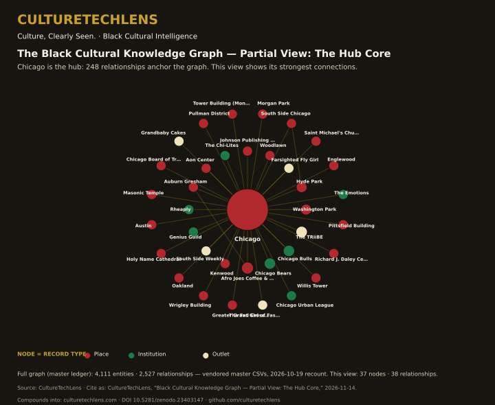

# CultureTechLens

**The Black Cultural Knowledge Graph: 3,488 evidence-graded records of Black history, music, sports, film, and technology — rooted in Chicago, open to be cited, and corrected in public.**

[](https://doi.org/10.5281/zenodo.23403147) [](https://creativecommons.org/licenses/by/4.0/) [](LICENSES.md) [](https://doi.org/10.5281/zenodo.23822179) [](https://github.com/culturetechlens/culturetechlens) [](https://github.com/culturetechlens/culturetechlens/releases) [](https://github.com/culturetechlens/culturetechlens/actions/workflows/counts-verified.yml)



*Partial view — the full stamped slice ships in `knowledge-graph/` below; the interactive version lives on this repo's Pages site (`docs/graph.html`).*

## Use it in 60 seconds

```python
import pandas as pd
e = pd.read_csv("knowledge-graph/entities.csv")   # 3,488 graded records
g = pd.read_csv("knowledge-graph/edges.csv")      # 2,162 relationships
print(e[e.kg_id == "CTL-P-0739"])                  # one entity: Beyoncé
```

New here? Run the [starter notebook](notebooks/ctl-graph-starter.ipynb) (Colab-ready), try the [starter queries](docs/starter-queries.md), or open the [interactive graph](https://culturetechlens.github.io/culturetechlens/graph.html).

**Also on GitHub:** the combined-graph dataset — [Dataset v2.0 (7,530 entities · 7,998 relationships)](https://github.com/culturetechlens-cpu/black-cultural-knowledge-graph), the larger research cut behind this slice, under the same concept DOI.


## Start with the data

- **Knowledge graph (stamped slice, in this repo):** [`knowledge-graph/entities.csv`](knowledge-graph/entities.csv) · [`knowledge-graph/edges.csv`](knowledge-graph/edges.csv) — 3,488 entities · 2,162 edges, every edge joining two stamped entities.
- **Current dataset release:** [v2.1 on GitHub](https://github.com/culturetechlens/culturetechlens/releases/tag/v2.1), archived on Zenodo as [10.5281/zenodo.23822179](https://doi.org/10.5281/zenodo.23822179) — 3,488 entities · 2,595 relationships. The release extract counts every relationship touching the verified set; the slice above counts only edges stamped at both ends. Both figures are correct — different cuts, named on purpose, never blended.
- **Counts, generated not typed:** [`counts.json`](counts.json)
- **Cite it:** [`CITATION.cff`](CITATION.cff) — the concept DOI [10.5281/zenodo.23403147](https://doi.org/10.5281/zenodo.23403147) always resolves to the current version.

## The datasets (counts as of October 19, 2026 — canonical source: [`counts.json`](counts.json))

| Dataset | What it is | Live / current | Public snapshot |
|---|---|---|---|
| [Knowledge Graph](knowledge-graph/) | What's connected: people, works, places, institutions, events of the Black world and everything with a real edge to it | **shipped here: the stamped slice — 3,488 entities · 2,162 both-endpoints-stamped edges** (VERIFIED 2,005 / STRONG EVIDENCE 1,483). The full working master (4,111 entities · 2,527 edges, incl. 623 UNVERIFIED seed-standard rows) stays internal under CTL Phase 0 (snapshot-only, 2026-10-19) | [v1.3, Oct 16, 2026](https://doi.org/10.5281/zenodo.23403147): 3,201 entities / 4,714 relationships — HISTORICAL snapshot; its "2,426 verified" figure is withdrawn by a pending Retraction-class erratum, do not cite as current |
| [Citation Register](citation-register/) | What CTL can prove: the Evidence Base, inside CTL-TAX-001 | 1,526 graded entries across 30 lanes (1,353 VERIFIED FACT), 0 Wikipedia-sourced | Register v9, Oct 18, 2026 |
| [Index](index/) | The CultureTechLens Index — a monthly, data-driven ranking of Black cultural resonance | Edition 2026-10 — **recovery package shipped: structured dataset deposited on Zenodo as v2 (Oct 24, 2026)** — per-signal scores (CSV), methodology (CTL-IDX-001), edition and ranked-table texts, candidate and evidence inputs, and the scoring script; citable as a structured dataset. (v1, Oct 1, 2026, was PDF only.) | [v2, Oct 24, 2026](https://doi.org/10.5281/zenodo.23612639): PDF + full structured dataset — concept DOI [10.5281/zenodo.23081629](https://doi.org/10.5281/zenodo.23081629) |
| [Reviews](reviews/) | What CTL recommends: CTL-REV-001 | 575 products / 115 categories · 575 links verified · 497 prices verified | Dataset v5.0 Tech Decoded, Oct 18, 2026 |
| [Film Canon](film-canon/) | The CTL film canon list (CTL-MUSE-001): 110 adopted films, CTL-FILM-001–110, 11 with a Chicago connection | List adopted through Oct 18, 2026 (Waves 1–3) — **list only; the film studies are optionable IP, not published here** |

## How we know — methodology

Every claim in these datasets carries an evidence grade (CTL-MTH-001: VERIFIED FACT / STRONG EVIDENCE / REASONABLE INFERENCE / HYPOTHESIS) and a named source. Standards live in [methodology/](methodology/) and are cited by ID, never restated. The scripts that generate every count in this repository live in [tools/](tools/) — the arithmetic is rerunnable, not asserted. Institutional rules — packaging, sponsorship, licensing — live in [governance/](governance/).

**Snapshot rule (CTL Phase 0, founder ruling 2026-10-19):** this repository publishes the stamped slice only — verified, citable data. Seed-standard (UNVERIFIED) material is never published here, labeled or not; it stays in the internal master until it earns a stamp. Dated snapshots live on Zenodo (above) and the live site: [culturetechlens.com](https://culturetechlens.com) · [By the numbers](https://culturetechlens.com/by-the-numbers/) · [Corrections](https://culturetechlens.com/crash-course/)

## Cite this repository

See [`CITATION.cff`](CITATION.cff). Concept-level citation preferred; cite a dated snapshot DOI when your claim depends on a specific count.

## Identity

CultureTechLens NFP · EIN 39-3143901 · PO Box 379244, Chicago, IL 60637-9233 · Wikidata [Q141705779](https://www.wikidata.org/wiki/Q141705779) · Founder/researcher ORCID [0009-0004-2837-8037](https://orcid.org/0009-0004-2837-8037) · info@culturetechlens.com

## Provenance

This flagship condenses two earlier repositories, archived read-only with their histories intact: `culturetechlens-index` (2026-09-28) and `culturetechlens-knowledge-graph` (2026-09-29). Nothing was deleted; the archive is the audit trail.

## Licence

Content (datasets, texts): CC BY 4.0. Code (tools, scripts): MIT. See [`LICENSES.md`](LICENSES.md). Citation is the mission — attribute and link, and you are welcome here.
